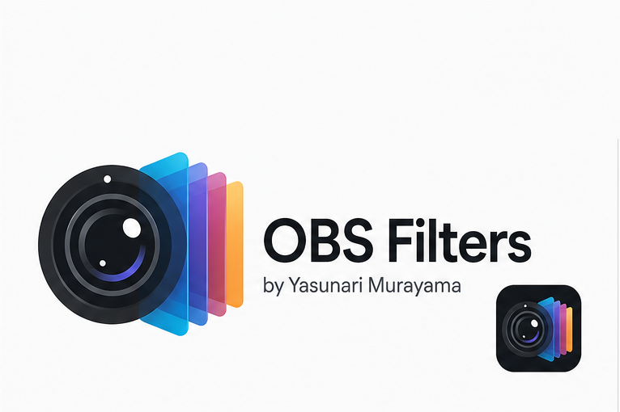
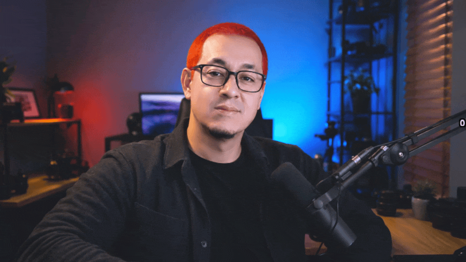
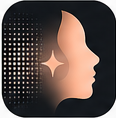
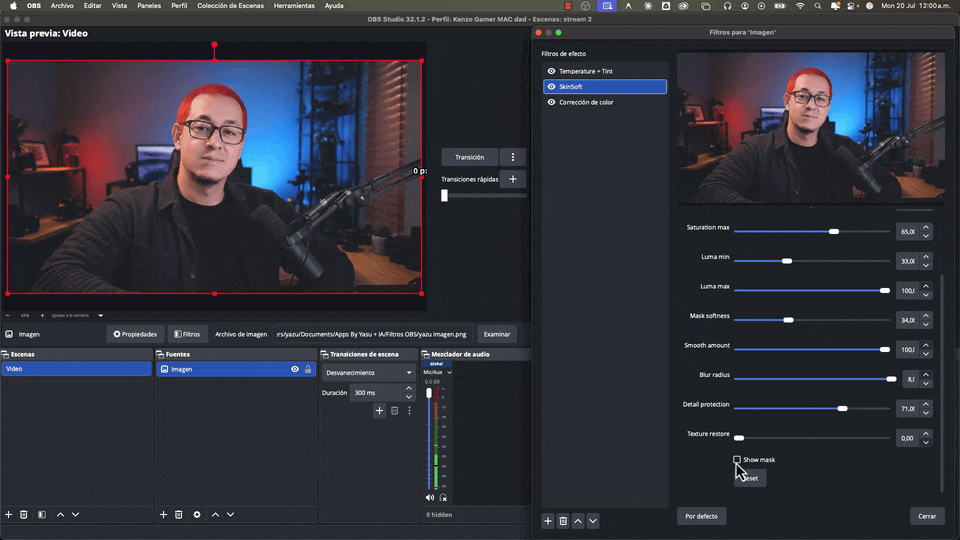
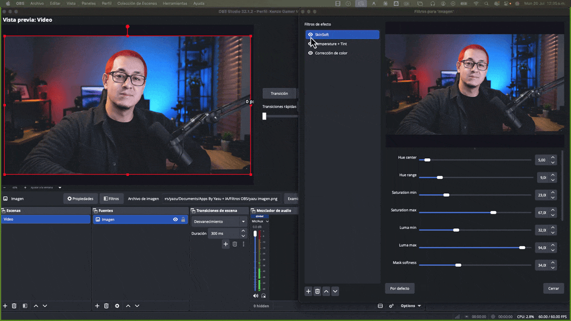

<p align="center">
  
</p>

<h1 align="center">OBS Filters by Yasunari Murayama</h1>

<p align="center">
  <strong>Real-time OBS Studio plugins for shaping the color, tone, and skin of a webcam or camera image — built by a colorist, for creators.</strong>
</p>

<p align="center">
  
  
  
  
</p>

<p align="center">
  
</p>

---

## Overview

Three OBS Studio filters designed to work **together** — giving a webcam or camera a cleaner, more controlled, slightly cinematic look, without a second camera app or a subscription.

| Filter | What it does | macOS | Windows x64 |
|---|---|:---:|:---:|
| **SkinSoft** | Selective skin smoothing with detail protection | ✅ | ✅ |
| **Temperature + Tint** | Visual white balance & color-cast correction | ✅ | ✅ |
| **Colorist Tone** | Exposure, contrast & tonal shaping | ✅ | ✅ |

All three are compiled, packaged, and verified loading in OBS Studio on both platforms — `.pkg` installers on macOS, `.exe` installers on Windows. Built against OBS Studio 31.1.1.

> I've worked in video production, color correction, motion design, VFX, and post-production for **15+ years**. These filters bring the way I approach an image in DaVinci Resolve into a real-time OBS workflow.

**Jump to:** [The filters](#the-filters) · [How they stack](#how-they-work-together) · [Under the hood](#under-the-hood) · [Repo map](#whats-in-this-repo) · [Download](#download)

---

## The filters

###  Temperature + Tint — visual white balance inside OBS

Move the image between cooler and warmer tones and correct unwanted green/magenta color casts — balanced **by eye**, the way temperature/tint corrections work in a color grade. Not calibrated Kelvin; a fast, intuitive visual adjustment.

**Good for:** warming/cooling a webcam · correcting green/magenta casts · skin tone under mixed lighting · matching different cameras · cleaner OBS Virtual Camera output.

`Controls:` Temperature · Tint · Mix · Reset

---

###  Colorist Tone — a more cinematic camera image

Deliberate control over the tonal structure: exposure, contrast, a contrast pivot, and independent shadows / lower mids / mids / upper mids / highlights — including lifted or washed blacks and controlled highlights. Not a generic "cinematic preset"; controls to shape each setup.

**Good for:** flat webcam images · exposure · contrast & pivot · lifting/deepening shadows · shaping midtones · taming highlights · adding depth.

`Controls:` Exposure · Contrast · Pivot · Shadows · Lower Mids · Mids · Upper Mids · Highlights · Mix · Reset

<p align="center"></p>

---

###  SkinSoft — subtle skin smoothing without blurring everything

Softens harsh webcam skin texture **without** turning the whole frame into a blur or a plastic face. It builds a **skin mask from hue, saturation, and luminance ranges** — so you control exactly what's softened — plus dedicated **Detail Protection** (keeps facial edges) and **Texture Restore** (mixes original texture back in). A **Show Mask** preview lets you dial the mask in first.

**Good for:** softening harsh skin texture · reducing the look of blemishes · preserving detail while smoothing · cleaner on-camera skin for TikTok Live, YouTube, Zoom, tutorials, and recordings.

`Controls:` Hue Center · Hue Range · Saturation Range · Luma Range · Mask Softness · Smooth Amount · Blur Radius · Detail Protection · Texture Restore · Show Mask · Reset

<p align="center"></p>

---

## How they work together

The three solve **different** parts of the same problem, so they stack cleanly.

<p align="center"></p>

**Recommended order**

```
1. SkinSoft            → selective skin smoothing
2. Temperature + Tint  → overall color balance
3. Colorist Tone       → exposure, contrast & tonal shaping
```

**Why SkinSoft goes first:** it builds its mask from the *hue, saturation, and luminance* of the source. A strong color correction before it would shift the skin tones and make the mask harder to isolate. Let SkinSoft read the original tones first, then balance color, then shape tone. A starting point, not a rule — every camera, skin tone, and light is different.

---

## Under the hood

A few decisions behind the filters, for anyone reading the code:

- **Perceptual skin masking.** Skin is isolated by HSL ranges (not a fixed color key), with a circular-aware hue distance so the red wrap-around is handled correctly. Keeps the mask stable across skin tones and lighting, and makes *Show Mask* genuinely useful for tuning. → [`skinsoft-filter/data/effects/skinsoft.effect`](skinsoft-filter/data/effects/skinsoft.effect)
- **Detail preservation over brute blur.** Naïve smoothing destroys eyes, hair, and pores. An edge estimate (`original − blurred`) drives *Detail Protection*, and *Texture Restore* mixes original texture back — soft where it should be, sharp where it matters.
- **Tonal control modeled on a grading workflow.** Colorist Tone's pivot + banded midtones mirror how I'd shape an image in Resolve, instead of a single brightness/contrast pair.
- **Real-time first.** Every choice is constrained by running live on a camera source, including feeding the OBS Virtual Camera.

Each filter is an independent native plugin: a small C source registers one `OBS_SOURCE_TYPE_FILTER`, loads one `.effect` GPU shader, and exposes clean sliders with defaults, reset, and localization.

---

## What's in this repo

```
obs-filters/
├── skinsoft-filter/          # SkinSoft plugin
│   ├── src/                  #   filter logic (C, libobs API)
│   └── data/effects/         #   skinsoft.effect (GPU shader)
├── temperature-tint-filter/  # Temperature + Tint plugin
├── colorist-tone-filter/     # Colorist Tone plugin
├── docs/
│   ├── design-spec.md        #   architecture & product direction (day-one design)
│   ├── implementation-plan.md#   task-by-task build plan
│   ├── brand-direction.md    #   brand & visual system
│   └── images/               #   demos, logo, icons
└── PROJECT_STATUS.md         # status, task history, decision log
```

Each filter is generated from the official [obs-plugintemplate](https://github.com/obsproject/obs-plugintemplate) — its own CMake build, CI workflow, and installer. Build artifacts and dependencies are excluded on purpose (see [`.gitignore`](.gitignore)); ready-made installers live on Gumroad.

> **How this was built.** I use AI-assisted development to accelerate implementation while retaining ownership of product definition, system design, integration, debugging, testing, documentation, and release decisions. The colorist judgment behind these filters — what a skin mask has to preserve, where a tone curve should pivot, which artifacts a viewer will notice — is the part no tool supplies. The `docs/` and `PROJECT_STATUS.md` are the working trail, kept on purpose so the *process* is as visible as the result.

📁 **Read the process:** [design spec](docs/design-spec.md) · [implementation plan](docs/implementation-plan.md) · [brand direction](docs/brand-direction.md) · [project status](PROJECT_STATUS.md)

---

## Download

Free (pay-what-you-want — enter `0`, or contribute to support development).

| Filter | Get it |
|---|---|
| **SkinSoft** | [yasunarimurayama.com/product/obs-skinsoft](https://yasunarimurayama.com/product/obs-skinsoft/) |
| **Temperature + Tint** | [yasunarimurayama.com/product/temperature-tint](https://yasunarimurayama.com/product/temperature-tint/) |
| **Colorist Tone** | [yasunarimurayama.com/product/obs-colorist-tone](https://yasunarimurayama.com/product/obs-colorist-tone/) |

📄 Full write-up & FAQ → **[yasunarimurayama.com](https://yasunarimurayama.com/free-obs-filters-by-yasunari-murayama/)**

---

## Who they're for

Livestreamers · YouTube & TikTok Live creators · gamers · online teachers · course creators · podcasters · church livestream teams · remote workers · video producers · anyone who wants a better camera image inside OBS.

---

## About

I'm **Yasunari Murayama** — video producer, motion designer, colorist, and developer of creative tools, with 15+ years in audiovisual production. My work spans video production, color correction, livestreaming, motion graphics, VFX, automation, and software development. These filters are part of a growing collection of practical tools built to solve real production problems.

- 🌐 Website — [yasunarimurayama.com](https://yasunarimurayama.com)
- 🛍️ All products — [murayama7.gumroad.com](https://murayama7.gumroad.com)

<sub>© Yasunari Murayama. Plugins built on OBS Studio (libobs, GPL). Source released under the terms in each plugin's <code>LICENSE</code>.</sub>
