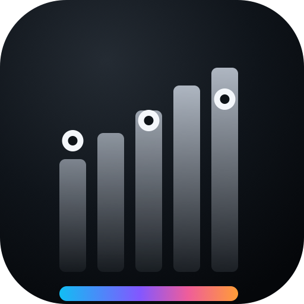
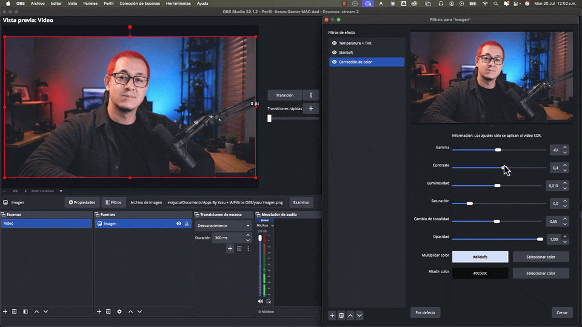

<p align="center"></p>

# Colorist Tone

**Native OBS Studio filter for shaping the tonal structure of a camera image — exposure, contrast and banded tonal control for a more cinematic look inside OBS.**

Part of [OBS Filters by Yasunari Murayama](../README.md) · macOS & Windows x64.

<p align="center"></p>

## What it does

Deliberate control over the tonal structure of the image: exposure, contrast, a contrast pivot, and independent shadows / lower mids / mids / upper mids / highlights — including lifted or washed blacks and controlled highlights. The goal is not a generic "cinematic preset," but controls to shape each setup, the way a colorist would.

**Good for:** flat webcam images · overall exposure · contrast and its pivot · lifting/deepening shadows · shaping lower and upper midtones · taming bright highlights · adding depth.

## Controls

| Control | Purpose |
|---|---|
| Exposure | Overall brightness |
| Contrast | Overall contrast |
| Pivot | The point contrast expands around |
| Shadows | Darkest tones |
| Lower Mids / Mids / Upper Mids | Independent midtone bands |
| Highlights | Brightest tones |
| Mix | Blend between original and graded |
| Reset | Return all controls to defaults |

## Build (macOS)

Built from the official OBS plugin template (requires CMake 3.28+):

```bash
python3 -m venv .build-venv
.build-venv/bin/python -m pip install --upgrade pip "cmake>=3.30,<3.31"
.build-venv/bin/cmake --preset macos
.build-venv/bin/cmake --build --preset macos
.build-venv/bin/cmake --install build_macos --prefix dist --config RelWithDebInfo
```

Install into the user's OBS plugin folder, then restart OBS:

```bash
mkdir -p "$HOME/Library/Application Support/obs-studio/plugins"
ditto "dist/obs-colorist-tone-filter.plugin" "$HOME/Library/Application Support/obs-studio/plugins/obs-colorist-tone-filter.plugin"
```

## Build (Windows x64)

Requires Visual Studio 2022 with the C++ desktop workload and the Windows SDK
(the `windows-x64` preset targets the `Visual Studio 17 2022` generator).
From this directory, in PowerShell:

```powershell
.github\scripts\Build-Windows.ps1
.github\scripts\Package-Windows.ps1
```

The scripts resolve the plugin root themselves and write the packaged plugin
to `release/`. A ready-made installer is available on the product page below.

## Source

- Filter logic — [`src/colorist-tone-filter.c`](src/colorist-tone-filter.c)
- GPU shader — [`data/effects/colorist-tone.effect`](data/effects/colorist-tone.effect)

## Download

Free (pay-what-you-want) → [yasunarimurayama.com/product/obs-colorist-tone](https://yasunarimurayama.com/product/obs-colorist-tone/)
